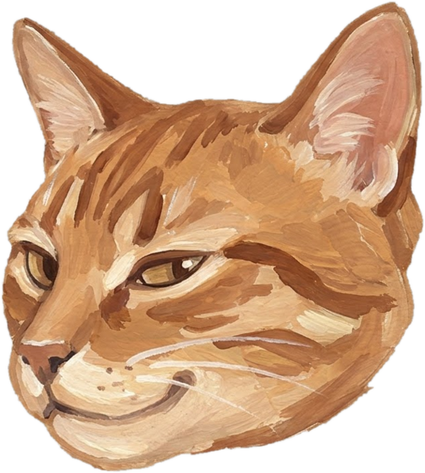

<p align="center">
  <picture>
    <source media="(prefers-color-scheme: dark)" srcset="assets/cat-head-dark.png">
    
  </picture>
</p>

# Tabby

Tabby is a set of six agent skills for Python projects, and for the Rust, C, C++ and Zig code behind a Python API. It works in OpenCode, GitHub Copilot and Claude Code. It makes the agent find the cause before the fix, reuse before it writes, keep the diff small, and never edit a test to get green.


<p align="center">
  <picture>
    <source media="(prefers-color-scheme: dark)" srcset="assets/cat-sleeping-dark.png">
    
  </picture>
</p>

## Install

Tabby is plain `SKILL.md` folders in the open [Agent Skills](https://agentskills.io/specification) format, so one copy of each folder works in all three tools. Pick your tool:

**Claude Code.** Run these as two separate prompts:

```
/plugin marketplace add RelativelyUnknown/my-skills
```

```
/plugin install tabby@tabby
```

On Claude Code 2.1.275 or later, one command does both: `/plugin install tabby --marketplace RelativelyUnknown/my-skills`.

**OpenCode and GitHub Copilot.** Clone the repository and copy the skills into your project:

```
git clone https://github.com/RelativelyUnknown/my-skills
cd your-project
python3 ../my-skills/tools/install.py agents
```

`agents` installs to `.agents/skills/`, which both tools read. Add `--user` to install for every project (`~/.agents/skills/`). Other targets: `github` (`.github/skills/`, Copilot), `opencode` (`.opencode/skills/`), `claude` (`.claude/skills/`, read by all three). The installer never deletes anything and skips folders that already exist unless you pass `--force`.

Install Tabby only from `RelativelyUnknown/my-skills` on GitHub.

| | Claude Code | OpenCode | GitHub Copilot |
| --- | --- | --- | --- |
| Skills load when the request matches | yes | yes | yes |
| Run the interview | `/tabby:interview` | `@interview` | `/interview` |
| Project memory file | `CLAUDE.md` containing `@AGENTS.md` | `AGENTS.md` | `AGENTS.md` or `.github/copilot-instructions.md` |
| Reminder before each prompt | optional hook (`hooks` skill) | paste [`remind.txt`](hooks/remind.txt) into `AGENTS.md` | paste [`remind.txt`](hooks/remind.txt) into `.github/copilot-instructions.md` |

## Example

Give the agent this bug report:

```
Bug report: `apply_discount(19.99, 15)` returns 16.9915 but the docstring says results are rounded to cents, half up. Fix it.
```

With Tabby, the agent writes a test that asserts 16.99, runs it and sees it fail, fixes the rounding, runs the whole suite, and leaves the existing tests alone. The eval case `evals/bug-fix-starts-red` checks each of those steps. To run it (needs the `claude` CLI; it costs a few cents):

```
python3 tools/eval/run.py --out results --cases bug-fix-starts-red --plugin . --plugin-dir . --model claude-haiku-5-5 --runs 3
python3 tools/eval/summarise.py results
```

## The six skills

The harness keeps the six descriptions in context (about 2,400 characters, roughly 600 tokens). When a task matches one, it loads that skill's body and only the files the body names for that task. The skills point at each other by relative path, so keep the folders side by side.

| Skill | The agent loads it when you | What it adds |
| --- | --- | --- |
| [`tabby`](tabby/) | write, fix, test, speed up, package or release Python, or the Rust, C, C++ or Zig behind it | Rules the agent never skips, and files on errors, typing, dependencies and uv, CI, performance, libraries, services, design, and native layouts, PyO3, the C API and wheels |
| [`tabby-review`](tabby-review/) | ask for a review of a diff or pull request, a repository audit or a security audit | Self-review, a security audit that separates confirmed bugs from look-alikes, and a checklist for the Python and native boundary |
| [`tabby-docs`](tabby-docs/) | write a README, docstrings, a tutorial, a changelog, an ADR or a runbook | One page type per reader need, and a check of the docs against the code |
| [`tabby-diagrams`](tabby-diagrams/) | ask for a diagram, an architecture picture or an animation | A builder that turns a small spec into an SVG or an HTML animation, and checkers for crowded labels, contrast and loop jumps |
| [`tabby-frontend`](tabby-frontend/) | build a page, dashboard, data app or docs site | A method, design tokens, a list of things it refuses to ship, and `ui-check` for contrast, focus, motion and layout |
| [`interview`](interview/) | run `/tabby:interview` | Researches the repository read-only, asks at most three questions a round, and saves a `## Tabby` section to `AGENTS.md` |

Skills load more reliably with a short reminder before each prompt. In Claude Code an optional hook in [`hooks/`](hooks/) prints it, and it is off by default; in the other tools the reminder lives in the instructions file (see the table above).

## The rules it holds

- Done means the real problem is solved and verified by running the code. Passing tests are evidence, not the goal.
- It never edits, deletes, skips or loosens an existing test to get green.
- It finds the cause before the fix. No special-casing inputs, no sleeps or retries to hide a symptom.
- It does not silence tools (`# type: ignore`, `# noqa`, `Any`, looser config).
- It keeps the diff small. It adds no dependency, changes no public API and makes no commit or push unless you ask.
- It uses your project's own tools, and reuses in this order: your project, the standard library, the community's standard library, then code you write yourself.

## Project memory

Tabby does the task first and never interviews you before it. Project memory lives in `AGENTS.md` for every tool. It infers the project from the repository and your request, and marks guesses `(assumed)`. `/tabby:interview` saves what the project is for and where it is going to a `## Tabby` section in `AGENTS.md`; later tasks read that section and ask before contradicting it. Tool and style defaults live in a `## Python defaults` section. Both are plain text you can edit.

## Measured effect

The same agent with and without Tabby on Claude Haiku 5.5, 98 eval cases, 3 runs each (`claude plugin eval`, regex and model-judged graders), 13 November 2026.

| | Without Tabby | With Tabby |
| --- | --- | --- |
| Mean score | 0.775 | 0.832 |
| Turns per run | 11.4 | 14.8 |
| Cost per run | $0.0131 | $0.0152 |

Tabby scored higher on 23 cases, lower on 11 and the same on 64. It helps most where a habit decides the answer: deprecating a public name instead of deleting it, taking a standard library instead of hand-rolling one, finding that a longer timeout is not the fix, and asking briefly when a request is vague. Where the bare agent already succeeds, Tabby only adds turns and cost.

Two further cases cover the rule on when to mock and when to test on real systems. They are not in the table above (Haiku 5.5, 13 November 2026):

| Case | With Tabby | Without Tabby |
| --- | --- | --- |
| `real-own-code-stubbed-edge` | 0.810 | 0.823 |
| `fake-needs-contract-test` | 0.89 | 0.78 |

On `real-own-code-stubbed-edge` the bare agent already tests its own code for real and stubs only the payment call, so the two are tied. On `fake-needs-contract-test` (six runs per arm), 4 runs with Tabby compared the fake with the real client, each against a local server, and 2 tested the fake alone; without Tabby the split was 2 and 4. Six runs per arm cannot show the difference is not chance.

On six small coding tasks (12 November 2026), hidden tests pass equally in both arms. With Tabby the agent adds fewer lint-rule violations (0.44 against 0.72 per run) and no narrating comments (0 against 1.28 per run).

Limits: measured on Claude Code only. The skills follow the same standard in OpenCode and Copilot, but those tools differ in how they load skills, in tool names and in permission prompts, and the evals have not been run there. One model family, three runs per case, and cases written by the same author as the skills, so the gain is likely overstated. A difference under about 0.3 on one case is noise. Large repositories and multi-turn work are not measured. The cases are in [`evals/`](evals/) and the runner is in [`tools/eval/`](tools/eval/).

## Links

- [`evals/`](evals/): the eval cases, trigger sets and seeded-audit fixtures
- [`tools/eval/`](tools/eval/): the runner, summaries, trace reader, quality, smell and judge tools
- [`THIRD_PARTY_NOTICES.md`](THIRD_PARTY_NOTICES.md): ideas adapted from other projects, with sources and licences
- [Issues](https://github.com/RelativelyUnknown/my-skills/issues)

## License

MIT. Fonts, icons and adapted material are credited in [`THIRD_PARTY_NOTICES.md`](THIRD_PARTY_NOTICES.md).
