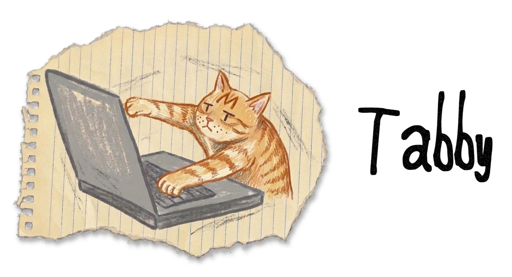
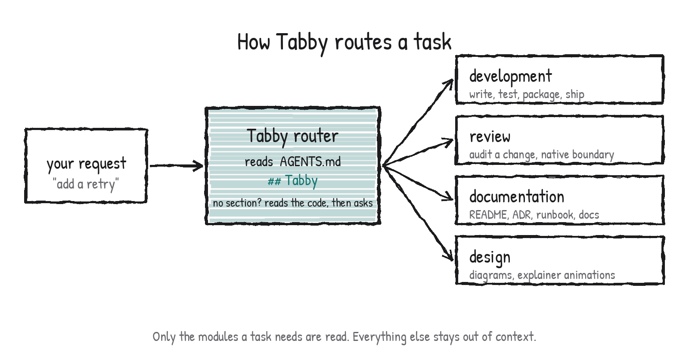
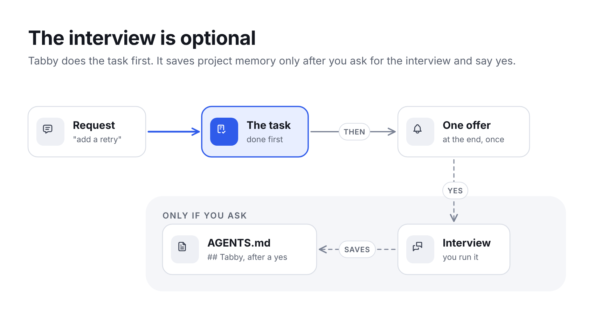
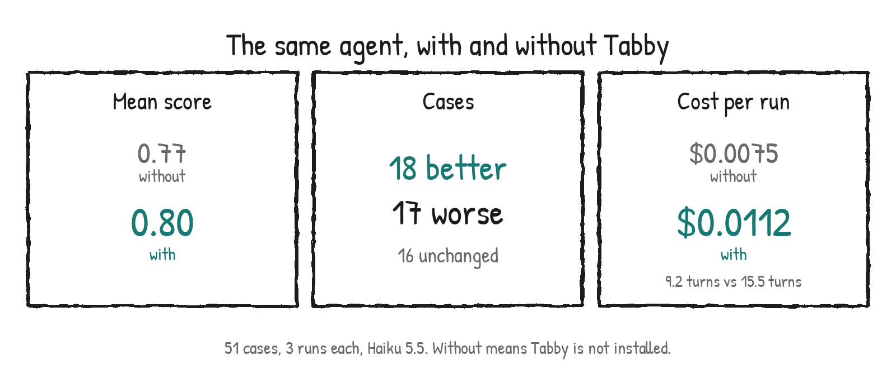
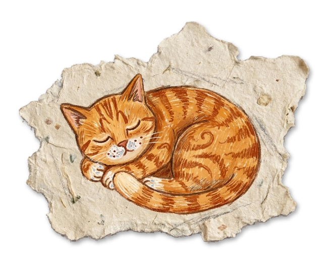

<p align="center">
  <picture>
    <source media="(prefers-color-scheme: dark)" srcset="assets/hero-dark.png">
    <source media="(prefers-color-scheme: light)" srcset="assets/hero-light.png">
    
  </picture>
</p>

<p align="center">
  <em>Cats walk across keyboards. This one has opinions.</em>
</p>

<p align="center">
  <strong>Skills that make an AI agent build, review and explain a project properly.<br>One folder. Python first, with Rust and C as first-class partners.</strong>
</p>

<p align="center">
  
  
  
  
</p>

<p align="center"></p>

You know the cat. It sits on the warm laptop, bats at the keys, and something gets typed. Fast, confident, not quite what you meant.

Tabby sits on your agent's keyboard instead. It reads the project first, asks three short questions, remembers the answers, and then makes the agent do the careful things a senior engineer would: find the cause before the fix, use the standard library, keep the diff small, and never edit a test to get it green.

Everything is markdown. No runtime, no daemon, no generated code. The agent reads a short front door, then only the few files its task needs.

## How it works

<p align="center">
  <picture>
    <source media="(prefers-color-scheme: dark)" srcset="assets/how-it-works-dark.png">
    <source media="(prefers-color-scheme: light)" srcset="assets/how-it-works-light.png">
    
  </picture>
</p>

One skill is registered with your agent: `tabby`. Four modules sit inside it, and the router opens only the ones a task needs, so a README fix never loads the Rust guidance and a Rust change never loads the writing guide.

## Three questions, then it remembers

<p align="center">
  <picture>
    <source media="(prefers-color-scheme: dark)" srcset="assets/interview-dark.png">
    <source media="(prefers-color-scheme: light)" srcset="assets/interview-light.png">
    
  </picture>
</p>

When a project starts, when the agent joins one, or when `AGENTS.md` has no `## Tabby` section:

1. It reads the repo first (pyproject, CI, native build files, docs) and does not ask what it can see.
2. It asks at most three questions in one round, each with a recommended answer. Questions the request already answers are skipped.
3. It restates the answers in six lines and waits for a clear yes.
4. It saves the `## Tabby` section to `AGENTS.md`. Edit any line later; a task that conflicts with it makes the agent ask first.

Your expected growth shapes the code. Say a hot path may move to Rust and the agent keeps that function behind one typed Python seam with a reference implementation, and builds no Cargo workspace until you ask. If nobody can answer (CI, or you are away), the agent writes the section from the repo, marks every unknown `(assumed)` and tells you what to confirm.

## What is in the box

| Module | What it does |
| --- | --- |
| [`tabby/engineering/`](tabby/engineering/) | Writing, testing, packaging and running Python: errors, minimalism, typing, dependencies and uv, CI, performance, libraries, services, workers, design patterns. Rust or C behind a Python API: layouts, PyO3, the C API, wheels and CI |
| [`tabby/review/`](tabby/review/) | Self-review of a change, a security audit that separates confirmed bugs from look-alikes, and a checklist for the Python and native boundary |
| [`tabby/documentation/`](tabby/documentation/) | Documentation by what the reader needs: tutorial, how-to, reference, explanation, docstrings, README, changelog, ADRs, runbooks, troubleshooting |
| [`tabby/design/`](tabby/design/) | Minimalist diagrams and explainer animations (SVG, MP4, WebM, GIF) |

## The rules it never lets slide

- Done means the real problem is solved and verified by running the code. Passing tests are evidence, not the goal.
- Never edit, delete, skip or loosen an existing test to get green.
- Find the cause before the fix. No special-casing inputs, no sleeps or retries to hide a symptom.
- Do not silence tools (`# type: ignore`, `# noqa`, `Any`, looser config); fix the cause.
- Smallest diff that solves it properly. No new dependency, public API change, commit or push unasked.
- Replies, comments and docs are short: what is not obvious, no filler.

<p align="center"></p>

## Numbers

<p align="center">
  <picture>
    <source media="(prefers-color-scheme: dark)" srcset="assets/scoreboard-dark.png">
    <source media="(prefers-color-scheme: light)" srcset="assets/scoreboard-light.png">
    
  </picture>
</p>

Measured with `claude plugin eval` on Haiku 5.5: 51 cases, 3 runs each, regex and LLM-judge graders. The router loaded in 97 of 114 runs.

**Where it helps:** when the right move is not obvious. A payment-method refactor scored 0.97 with Tabby and 0.39 without; free-form date parsing (take a library, do not write a regex) 0.57 and 0.13; a security audit 0.98 and 0.75; numpydoc docstrings 1.00 and 0.67; an optional dependency kept out of the base install 0.69 and 0.39.

**Where it does not:** on tasks the bare agent already does well it can lose ground. A flaky-HTTP retry scored 0.52 with Tabby and 0.91 without; an async generator that must stop early 0.67 and 1.00; adding an owned-resource endpoint 0.11 and 0.44. It also costs more: about half again per run, with more turns, because it reads before it writes.

The score gap is small (+0.03), so the honest summary is mixed: large gains on a few non-obvious cases, small losses on several easy ones. **Limits:** one model, three runs, one judge, no shell in the eval sandbox. The cases are in [`tabby/evals/`](tabby/evals/). Tabby has not been run in GitHub Copilot.

## Install

Copy the one folder into the folder your agent reads:

```bash
# Claude Code
mkdir -p .claude/skills && cp -r tabby .claude/skills/
# GitHub Copilot (VS Code agent mode, CLI)
mkdir -p .github/skills && cp -r tabby .github/skills/
```

Delete `tabby/evals/` if you do not run evals. Any agent that reads `SKILL.md` folders and `AGENTS.md` can use it. Claude Code reads `CLAUDE.md`, not `AGENTS.md`: if your repo has no `CLAUDE.md`, add one line, `@AGENTS.md`.

## FAQ

<picture>
  <source media="(prefers-color-scheme: dark)" srcset="assets/cat-sleeping-dark.png">
  <source media="(prefers-color-scheme: light)" srcset="assets/cat-sleeping-light.png">
  
</picture>

**Where does it keep what it learns?** In your repo, in `AGENTS.md`, under `## Tabby` (what the project is for and where it is going) and `## Python defaults` (tools and style). Plain text; edit it like anything else.

**Do I have to answer questions?** No. Without anyone to ask it fills the section from the repo and marks what it guessed.

**Does it work for Rust and C?** Yes, as extensions behind a Python API: when to go native, project layouts, PyO3 and the C API, wheels, CI, and a review checklist for the boundary. Standalone Rust or C projects are out of scope.

**What about TypeScript?** Not yet.

**What does it cost in context?** One short description is always loaded. The router and a module index load when a task needs them, then only the reference files that task names.

<br clear="left">

## Planned

- TypeScript and JavaScript support.

## Where the ideas came from

Tabby takes ideas, rewritten in its own words, from [ponytail](https://github.com/DietrichGebert/ponytail), [caveman](https://github.com/JuliusBrussee/caveman), [BeautifulRust](https://github.com/morganlinton/BeautifulRust), [Cloudflare's security-audit skill](https://github.com/cloudflare/security-audit-skill), [addyosmani/agent-skills](https://github.com/addyosmani/agent-skills), [impeccable](https://github.com/pbakaus/impeccable), [diagram-design](https://github.com/cathrynlavery/diagram-design), [stack-diagram](https://github.com/caru-ini/stack-diagram) and others. Adapted material keeps its licence; see [`THIRD_PARTY_NOTICES.md`](THIRD_PARTY_NOTICES.md).

## Credits and licence

MIT. The Tabby title is set in "Pizza is my FAVORITE Font" by Kimberly Geswein (freeware; commercial use requires a donation, see [fontspace](https://www.fontspace.com/pizza-is-my-favorite-font-f11293)). Only the rendered image is in this repository, not the font file. Pictures are drawn in the Patrick Hand typeface (SIL Open Font License).
